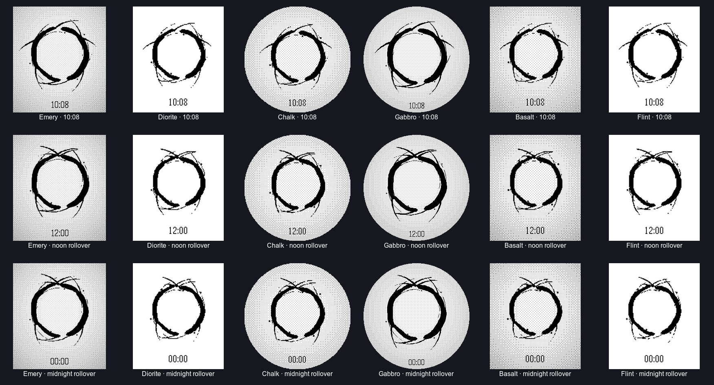

# Heptapod for Pebble



A Pebble watchface where a broken ring of ink tells the time. Three tendrils
grow from their clock positions: long for hours, medium for minutes, short for
seconds. Twelve stays at the top while the ring breathes and the brush tips
sway in drifting mist.

[Get it on the Pebble Appstore](https://apps.repebble.com/eed88192a6a24a229eceb50c).
Version 0.1.5 runs on Pebble Time and Time Steel (Basalt), Pebble Time Round
(Chalk), Pebble 2 (Diorite), Pebble Time 2 (Emery), Pebble 2 Duo (Flint) and
Pebble Round 2 (Gabbro). One package covers all six. The round artwork is
scaled evenly to fit rectangular screens.

It works offline. Two settings in the Pebble phone app:

- **Bottom digital clock**: on by default. It follows the watch's 12/24-hour
  setting.
- **Calm motion**: off by default. Normal motion redraws four times a second;
  calm motion freezes the mist and updates once a second.

Drawing pauses when another app takes focus.

The face is inspired by the film *Arrival*. It is not affiliated with the film
and does not translate its fictional language. It contains no film glyph
assets.

## How it works

I made the original [Heptapod B clock](https://datapoems.io/clocks/heptapod/)
for the web; its HTML is kept in [reference/source.html](reference/source.html).
This port keeps its six arcs, twelve ornamental flourishes, six ink blots and
the proportions of the three time tendrils.

The brush outline is built from native pressure-expanded ribbons; the port
uses none of the web version's freehand-drawing library. Color and
black-and-white watches both get drifting, dithered clouds and a blurred ink
halo. A half-resolution mask supplies the smoke, while the outline stays sharp
enough to keep the small tendrils visible.

The geometry keeps no hidden clock state. A caller-owned workspace avoids
large stack arrays, firmware trig replaces desktop libm, and small sampled
pressure curves keep the original taper. See
[reference/README.md](reference/README.md) for the differences from the web
version.

## Build and test

You need Pebble SDK 4.33.1 with pebble-tool 5.0.39, a C compiler with
sanitizers, and the Python environment that comes with pebble-tool (it
includes `libpebble2` and `pypng`). Set `PYTHON` if your shell's `python3` is a
different environment.

```sh
make build PYTHON=python3
python3 test/package_test.py
python3 test/emulator.py basalt --fresh
python3 test/emulator.py gabbro --fresh
make package PYTHON=python3
```

`make build` runs the geometry tests first. They check 18,688 time, shape and
clock-option samples, motion with the atmosphere frozen, and cardinal angles,
then run again with fixed-point angles. Both runs use AddressSanitizer and
UndefinedBehaviorSanitizer.

`test/emulator.py` creates a new, isolated emulator profile, installs the
production PBW, checks second-to-second changes and the noon and midnight
rollovers, and saves screenshots. It never connects to a real watch.
`make package` checks each payload's size and CRC and builds a source ZIP.
`make icon` regenerates the 25×25 menu icon from the same geometry; it needs
ImageMagick.

`release/` holds the 0.1.0, 0.1.1 and 0.1.2 packages. The screenshots in
`evidence/` (including [a motion preview](evidence/emery-motion.gif)) come
from 0.1.2, which had no digital clock. Build logs in earlier commits and the
release archives contain absolute paths from the original build machine.

## License

MIT. See [LICENSE](LICENSE). The web version's font and drawing library are
not part of this port.
